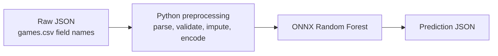

# Assessment 2 — Random Forest production service

This folder is inference/release code, separate from modeling and the fictional Azure design. It serves the fixed Random Forest through **FastAPI + CPU ONNX Runtime**. No training, pickle/joblib loading or model download occurs during API startup or requests.

## Simple prediction flow



`steam_service/preprocessing.py` accepts a record with the original field names; the Python preprocessing layer also uses shared fixed features and the artifact's fitted medians/vocabularies. The client does not need to construct model features.

Example request (a subset of the full CSV record):

```json
{
  "AppID": 20200,
  "Name": "Galactic Bowling",
  "Release date": "Oct 21, 2008",
  "Price": 19.99,
  "Required age": 0,
  "Windows": true,
  "Mac": false,
  "Linux": false,
  "Achievements": 30,
  "Genres": "Casual,Indie,Sports",
  "Tags": "Indie,Casual,Sports,Bowling"
}
```

Illustrative success response (not a measured prediction for the example game):

```json
{
  "is_success": true,
  "predicted_owner_range": "20000 - 100000",
  "probability": 0.64,
  "model_version": "steam-rf-onnx-v1"
}
```

`probability` is the winning class's probability, not all three class probabilities or a calibration guarantee. `model_version` comes from the loaded artifact; exporting a version named `1.0.0` would return that value rather than a hard-coded version.

**Range granularity:** the trained classifier has three categories: `0 - 20000`, `20000 - 100000`, and `100000 - 200000000`. Lower bounds are inclusive and upper bounds exclusive, except the final upper bound. It cannot return the narrower source interval `20000 - 50000`; that requires a new target definition, retraining and evaluation. Do not relabel the middle class as that narrower range.

A failed request preserves its meaningful HTTP status (for example 422 for invalid input, 401/403 for authorization, 503 for unavailable capacity) and returns `is_success: false` with `detail`; no invented prediction is returned.

## Model and preprocessing release contract

```text
models/steam-rf-onnx-v1/
  model.onnx          # RandomForestClassifier only, float32 input, dense class probabilities
  preprocessing.json # ordered numeric inputs, fitted medians, binary genre/tag vocabularies
  manifest.json      # version, hashes, classes, inference dependencies, parity/provenance
```

The full path is **raw CSV-shaped JSON → Python preprocessing → ONNX Random Forest → prediction JSON**. The custom Python tokenizer and row-wise features are deliberately kept outside the ONNX graph; converting just the classifier and forgetting fitted preprocessing would be incorrect. Unknown tags/genres are ignored by the stored vocabulary, and missing numeric values use training medians. The serving code does not learn from requests.

`steam_service/export.py` is training-side only. It accepts the declared fitted sklearn `features`/`model` pipeline with a median imputer retaining empty columns, binary genre/tag CountVectorizers and a three-class RandomForestClassifier. It rejects text, scaling or undeclared encoders rather than approximating them. The release gate checks **consumed** raw features (unused descriptions do not enter this forest), encoded float32 matrices, class predictions and probabilities (maximum absolute error 2e-5) on paired examples. Future engineered-input models need corresponding parity coverage and a reviewed feature contract.

`steam_service/artifacts.py` is runtime only: verify ONNX/JSON checksums, schema, class order, feature width and compatible inference package versions, load a one-thread CPU session and warm it up. Failed/missing artifacts fail startup. Checksums detect corruption; use trusted/signed image publishing for authenticity. Models are immutable, and the graph alone cannot guarantee identical results for every possible float-boundary input. Revalidate conversion whenever the converter, runtime, model or preprocessing changes.

## Export

Use section 14 of `assessment_1_modeling/notebooks/steam_model_experiments.ipynb` for an already fitted fixed forest, or the documented offline refit command in the root README. The latter verifies recorded data/splits and uses 1,500 stratified non-test examples for release parity. No new model performance claim comes from conversion tests.

## Local service

The package source lives at `assessment_2_production/steam_service/`, but Python imports remain `steam_service.*`. The root requirements and Poetry dependency configuration install it in editable mode. If using the production folder alone, install it from the repository root:

```bash
python -m pip install -e ./assessment_2_production
```

Then, from the repository root:

```bash
AUTH_MODE=disabled MODEL_DIR=models/steam-rf-onnx-v1 \
  python -m uvicorn steam_service.app:app --host 127.0.0.1 --port 8000
```

`AUTH_MODE=disabled` is an explicit loopback-only development choice. Default authentication is **Entra**, and startup fails without its required configuration. `/docs`, `/redoc` and `/openapi.json` are disabled; the raw-record schema is defined in `steam_service/preprocessing.py`, and the response in `steam_service/schemas.py`.

```bash
curl --fail-with-body http://127.0.0.1:8000/predict \
  -H 'Content-Type: application/json' \
  --data-binary @assessment_2_production/examples/predict.json
```

| Endpoint | Behavior |
| --- | --- |
| `POST /predict` | One CSV-style game record → `is_success`, `predicted_owner_range`, winning-class `probability` and `model_version`. |
| `GET /model` | Authenticated model metadata and class definitions. |
| `GET /health/live` | Lightweight process check, unauthenticated for probes. |
| `GET /health/ready` | Loaded/warmed model check, unauthenticated for probes. |

`AppID`, `Name` and `Release date` are required. A full record is in `examples/predict.json`; the smaller predictor-focused example is `examples/predict-minimal.json`. Full CSV records are accepted, including unused columns such as `Estimated owners`, `Positive`, screenshots and movies. Only allowlisted predictors are forwarded; identity/outcome fields do not affect prediction, and URLs are never fetched. Other unrecognized fields are discarded, so clients should use the exact documented CSV spelling.

The Python preprocessing module accepts JSON numbers/booleans and their CSV string forms, comma-separated genres/tags/categories and list representations such as `"['English', 'French']"`. JSON arrays are also supported. Dates accept `YYYY-MM-DD`, `Mon DD, YYYY` or `Mon YYYY`; a month-only date is assigned day 1, matching offline preprocessing. Missing optional numeric/platform fields stay missing for the fitted imputer. Empty list/text fields are supported. Invalid nonmissing numeric values, nonfinite numbers, unrecognized booleans and malformed dates return 422.

A CSV record has no observation date. By default, game age is computed at the **loaded artifact's training observation date** (2023-07-05 for this release), preserving the existing feature definition without silently using today's date. Optional `As of date` accepts an ISO date for an explicitly chosen reference date. The one-year eligibility rule still applies; supplying a later date does not establish validated performance at that horizon. These are historical cumulative-owner estimates, not pre-launch download forecasts.

Descriptions are capped at 100,000 characters, labels at 200 characters and request bodies at 256 KiB, including streamed requests. Do not send nonstandard JSON NaN/Infinity values; use null for missing values. Capacity saturation returns 503 + `Retry-After: 1`; clients should use bounded retries with jitter. Logs omit input payloads and tokens; request IDs, route templates, status and total HTTP duration remain available. Detailed internal probabilities and inference timings are not included in the compact prediction response; benchmark HTTP latency with the load-check script.

## Entra authorization

The default `AUTH_MODE=entra` requires:

```text
ENTRA_TENANT_ID=<single-tenant GUID>
ENTRA_AUDIENCE=<API application/client GUID, v2 token audience>
ENTRA_ALLOWED_CLIENT_IDS=<comma-separated approved client application GUIDs>
ENTRA_REQUIRED_ROLE=Steam.Predict
```

Register a v2 API, define/grant the application role and allow only the approved client applications. FastAPI verifies RS256 signature using cached tenant-specific signing keys, issuer/audience/tenant, expiration/not-before, authorized client (`azp`) and role. Missing/invalid tokens return 401; valid but unapproved clients/roles return 403. Controlled HTTPS access to Entra is required for signing-key refresh; key-fetch failures return 503. This implements app-level verification, not trusted incoming identity headers. The Azure template keeps authentication enabled. Private networking adds an independent boundary; neither tenant membership nor VNet access alone grants permission.

## Build a release container

The release image contains **one artifact bundle**, so its digest identifies code + model + preprocessing. Stage a minimal context; do not build from the repository root:

```bash
python assessment_2_production/scripts/prepare_release.py \
  --model-dir models/steam-rf-onnx-v1 --output /tmp/steam-rf-release

docker build -t steam-rf:3.0.0-steam-rf-onnx-v1 /tmp/steam-rf-release

docker run --rm --name steam-rf-local \
  -p 127.0.0.1:8000:8000 --read-only \
  --tmpfs /tmp:rw,noexec,nosuid,size=64m \
  --cap-drop ALL --security-opt no-new-privileges \
  --cpus 1 --memory 2g -e AUTH_MODE=disabled \
  steam-rf:3.0.0-steam-rf-onnx-v1
```

The non-root image excludes datasets, notebooks, tests, training libraries and the exporter. One Uvicorn worker loads one ONNX session; bounded request concurrency defaults to four in the container and ONNX runs with one CPU thread. Scale using Container Apps replicas. The Dockerfile pins the Python base-image digest used for local verification; review/update that digest and scan/sign the release before publishing. Registry credentials, tokens and tenant/client configuration are never baked into the image. Model artifacts themselves are confidential; keep the image in private ACR.

Regenerate runtime dependencies using `python assessment_2_production/scripts/lock_service.py` after an intentional inference dependency upgrade, then re-export and retest. Dependencies for conversion belong in the root modeling environment; `steam_service/export.py` is deliberately absent from the Docker release context. Roll back the image/model pair together.

## Verification and Azure handover

```bash
python -m pytest tests/production -q
```

Tests cover actual ONNX conversion/parity, fresh-process loading without sklearn/CatBoost, missing/unseen metadata, invalid requests, corrupt artifacts, CPU capacity, JWT signature/claim/role checks and authenticated routes. Synthetic fixtures test behavior; they are not the production model. Use the separately exported real-data artifact for a staging container smoke/load test and review the quick/full provenance before release approval.

A small reproducible burst check is available after starting the local container:

```bash
python assessment_2_production/scripts/load_check.py --requests 100 --concurrency 2
```

For a private authenticated staging endpoint, provide its URL and set `LOAD_TEST_BEARER_TOKEN` securely in the environment. The script reports end-to-end HTTP p50/p95, throughput, status counts and response-contract success. This short burst does not prove an Azure availability SLO or autoscaling behavior.

Recorded checks are in [VERIFICATION.md](VERIFICATION.md).

See [the infrastructure blueprint](../assessment_3_infrastructure/azure-blueprint.md) for the presentation diagram, private DNS/ingress, managed identity for ACR, zone redundancy, scaling, monitoring, rollback and remaining environment-specific steps. Nothing here deploys to Azure.
