# Assessment 3 — development-first, private Azure deployment

This is a fictional deployment design, not a deployed environment. It follows the supplied [Azure deployment reference](../assessment_4_presentation/Azure%20ML%20Production%20Deployment%20Architecture.png): **local modeling → CI → private DEV deployment → debugging and tests → manual approval → PROD promotion**. Assessment 2 implements the FastAPI/ONNX service and local release tooling; the cloud environments and promotion pipeline below are proposed, not implemented. The selected production learner is the **fixed Random Forest**; CatBoost remains an experiment comparator. No cloud resources are created by the code or instructions below.

## Presentation blueprint

```mermaid
flowchart LR
    TRAIN["Local modeling
Frozen Random Forest + ONNX + JSON"] --> REPO["Protected source + release record"]
    REPO --> CI["CI
Unit tests, parity, build, security scan"]
    CI --> DEVACR["Private DEV ACR
Candidate image digest"]
    CI --> DEVBLOB["Private DEV Blob
Versioned model bundle + hashes"]
    subgraph DEV["DEV: rg-steam-dev / vnet-steam-dev"]
      DEVAPP["Internal Container Apps
FastAPI + ONNX Runtime
Candidate image + bundled model"]
      DEVTEST["Debugging + integration tests
Identity, private access, behavior, load, rollback"]
      DEVMON["DEV monitoring and test reports"]
      DEVAPP --> DEVTEST
      DEVAPP --> DEVMON
    end
    DEVACR -->|"Deploy candidate"| DEVAPP
    DEVBLOB -. "Release provenance" .-> DEVTEST
    ENG["ML engineers
Approved DEV clients only"] -->|"Private network + DEV token"| DEVAPP
    DEVTEST -->|"All gates pass"| APPROVE["Independent manual approval
Exact tested digest + report"]
    APPROVE --> PROMOTE["Protected promotion job
Copy same image + artifacts; verify hashes
No rebuild or retraining"]
    PROMOTE --> PRODACR["Private PROD ACR
Approved image digest"]
    PROMOTE --> PRODBLOB["Private PROD Blob
Approved immutable model bundle"]
    subgraph PROD["PROD: rg-steam-prod / vnet-steam-prod"]
      INGRESS["Private HTTPS ingress
PROD audience + client-role authorization"]
      A["Healthy replica A
FastAPI + ONNX Runtime"]
      B["Healthy replica B
FastAPI + ONNX Runtime"]
      MON["PROD monitoring + alerts"]
      INGRESS --> A
      INGRESS --> B
      A --> MON
      B --> MON
    end
    PRODACR -->|"New approved revision"| A
    PRODACR -->|"Same release"| B
    USERS["Authorized Valve business applications"] -->|"Private DNS + PROD token"| INGRESS
    ENTRA["Microsoft Entra ID
Separate DEV / PROD audiences and clients"] -. "Token validation" .-> DEVAPP
    ENTRA -. "Token validation" .-> INGRESS
```

**Release path:** there is no CI → PROD deployment shortcut. A candidate must run in DEV and pass its report/approval gate before production permissions are available. A failed or changed candidate returns to CI/DEV, while production keeps its previous approved revision.

**Request path:** business application → private ingress → authenticated FastAPI → Python preprocessing of a CSV-shaped JSON record → ONNX Random Forest → success/range/probability/version. Entra tokens are verified in FastAPI; network membership alone does not grant access. Diagram token-validation edges denote trust, not Entra sending prediction requests.

## Environment separation and access

| Boundary | Development (DEV) | Production (PROD) |
| --- | --- | --- |
| Purpose | ML engineering debugging, integration, security and release testing | Approved internal business predictions |
| Resource group and network | `rg-steam-dev`, `vnet-steam-dev`, dedicated internal Container Apps environment | `rg-steam-prod`, `vnet-steam-prod`, separate internal Container Apps environment |
| Access | Approved engineering/test applications with DEV audience/role | Approved business applications with PROD audience/role; no general developer access |
| Registry and model archive | Separate private DEV ACR and DEV Blob account | Separate private PROD ACR and PROD Blob account; approved artifacts only |
| Runtime identity | DEV-only registry pull permissions | PROD-only registry pull permissions; no DEV write permissions |
| CI/CD identity | DEV deployer cannot change PROD | Protected promotion identity; becomes available only after DEV evidence and approval |
| Replicas | Normally min 0 / max 4 for cost; temporarily min 2 for failover tests | Min 2 / max 4, with zone redundancy enabled at environment creation |
| Monitoring and data | DEV logs/reports; synthetic or approved test records | PROD logs/alerts with restricted access; avoid raw payload logging |

Prefer separate subscriptions if Valve requires stronger policy/budget boundaries. Separate resource groups alone are not security isolation: enforce network routes, scoped Azure RBAC and separate Entra audiences/client-role assignments. Do not peer DEV directly into PROD by default. Protect CI runner access so unreviewed development code cannot obtain PROD deployment permissions. Model promotion rights are separate from the ability to call `/predict`.

Both environments preserve the same request and model/preprocessing contracts. Environment-specific values (audience, clients, network, replica count and alert destinations) may differ, but changing model files, code or dependencies produces a new candidate that must repeat the gates.

## How the reference image maps to the existing implementation

| Reference element | Adopted design and implementation boundary |
| --- | --- |
| DEV before PROD | Required: candidate deployed to DEV for debugging/testing; manual approval and same-release promotion precede PROD. |
| CI/CD | Proposed protected Azure DevOps multi-stage pipeline on private runners; implementation and cloud credentials are not supplied as a live deployment workflow. The companion [promotion plan](release-promotion.md) defines dependencies and acceptance gates. |
| Blob Storage per environment | Private, versioned artifact archives for `model.onnx`, `preprocessing.json`, manifest and release evidence. DEV artifacts are candidates; PROD receives approved bytes only. CI/promotion jobs read/write these archives with scoped identities. |
| Model loaded at startup | Existing service checks and loads the immutable bundle already inside its image. Blob is not a runtime dependency in this implementation. |
| “Mounted from Blob” | Do not implement as a native Container Apps Blob volume: it is not supported. A future startup downloader/init container plus replica-local storage would require additional code, permissions, checksum validation and failure tests; it is not included here. |
| `preprocessing.joblib` / schema files | Keep the implemented `preprocessing.json` + manifest, including schema version and hashes; do not reintroduce executable pickle/joblib loading. |
| Prediction response | Keep the implemented compact `is_success`, `predicted_owner_range`, winning-class `probability` and actual `model_version` response in both environments. |
| SSO and teams | Team access is enforced by the internal business application; FastAPI retains machine-to-machine Entra token validation with separate DEV/PROD allowlists. Direct delegated-user SSO would require an explicit additional authorization design. |

This preserves the reference's environment separation, private access, promotion and monitoring while keeping the blueprint honest about the working ONNX/JSON service. Microsoft explicitly documents [Container Apps storage support](https://learn.microsoft.com/en-us/azure/container-apps/storage-mounts).

## Services and reasons

| Service / tool | Role in this design |
| --- | --- |
| Azure Container Apps, workload profiles environment | Managed container scheduling, HTTPS ingress, replicas, revisions and autoscaling, avoiding Kubernetes administration for a small stateless API. |
| VNet-integrated internal environment | Private load-balancer endpoint for approved network paths. Reserve a dedicated `/23` environment subnet for capacity headroom and separate subnet(s) for private endpoints. Apply platform-required network rules. |
| Private DNS and corporate DNS forwarding | Resolve the Container Apps environment domain to its internal IP from the VNet, peered networks and VPN clients. Network connectivity alone does not authorize prediction. |
| Microsoft Entra ID | Service-to-service identity: v2 access tokens with the `Steam.Predict` application role and an allowlisted client application ID. The API validates signature, tenant, issuer, audience, time claims, role and authorized client. |
| Azure Container Registry, Premium + private endpoint | Private image/model distribution; disable public network access and the admin account. Use a user-assigned managed identity with registry-scoped `AcrPull` under classic registry RBAC; choose the corresponding repository-reader role if using ABAC-enabled permissions. |
| Azure DevOps pipeline + private runners + federated identities | CI, DEV deployment/testing and a protected PROD promotion stage. Separate identities and network scopes per environment; no long-lived deployment passwords in source. |
| Private Azure Blob Storage, one account per environment | Candidate/approved artifact archives and test evidence; public access disabled, private endpoints and versioned paths. Release jobs have scoped read/write access; the serving containers need no Blob permission with bundled artifacts. |
| Azure Monitor / Log Analytics | Platform replica/CPU/memory/request metrics, structured application logs and alerts. Restrict workspace access to operational teams. |
| Git + immutable artifact/image versions | Trace model source, dataset/split checksums, ONNX conversion checks and rollback history. The model is baked into each image; serving needs no Blob Storage model download or shared writable filesystem. |

Private Container Apps environment and app ingress are separate settings. Use an **internal environment with public network access disabled**, but app ingress `external: true` so clients elsewhere in the VNet can reach the private environment load balancer. `external: false` would restrict callers to the same Container Apps environment. This combination is private because the environment itself has no public endpoint. [Microsoft networking documentation](https://learn.microsoft.com/en-us/azure/container-apps/networking), [ingress reachability](https://learn.microsoft.com/en-us/azure/container-apps/connect-apps).

For the internal environment, create a private DNS zone matching its assigned `defaultDomain`, point wildcard `*` (and the zone apex as needed) to the environment static internal IP, and link the client VNets. Corporate/VPN clients need conditional forwarding through an Azure DNS resolver or equivalent. Keep registry and Blob private DNS zones separate from the Container Apps domain and link them to the authorized runner/client networks; verify resolution from both client and private CI networks before testing HTTPS.

ACR private endpoints require the appropriate registry tier and private DNS/connectivity for both the registry and image-layer data endpoints; the private runner and Container Apps environment must resolve/reach them. [ACR private endpoints](https://learn.microsoft.com/en-us/azure/container-registry/container-registry-private-endpoints).

## Capacity, availability and scaling

The requirement **at least 100 requests/hour** is a lower bound, averaging about **0.028 requests/second**, not a peak-load specification. Ask the application owners for burst rate, concurrent callers, payload sizes, latency expectations and future growth. Propose, rather than claim as achieved, p95 <500 ms and 99.9% monthly availability; confirm them in staging and agree a business SLO.

For **PROD**, start with **1 vCPU / 2 GiB per replica, minimum 2, maximum 4**, one Uvicorn worker, ONNX Runtime CPU threads fixed at one, and four in-flight predictions per replica. Use an HTTP concurrency scaling target of four, then tune it from measured queueing, saturation and CPU. The two always-on replicas are for availability and cold-start avoidance, not justified by 100/hour throughput. Autoscaling reacts over time and cannot absorb every instantaneous burst; clients need bounded retries with jitter for transient 503/429 responses. [Container Apps scaling](https://learn.microsoft.com/en-us/azure/container-apps/scale-app).

DEV normally uses one replica for debugging and two during release resilience tests; this does not claim always-on DEV zone availability. Use production-like settings for capacity/failover tests and document intentional differences.

Choose a region supported by Valve's residency policy (for example West Europe), verify current region/zone support and quotas, and enable **zone redundancy when creating the workload-profiles environment**. Set minimum replicas ≥2 for zone distribution. This mitigates host/zone failures, not region-wide outages; a second region is a separately costed requirement if the agreed RTO demands it. [Container Apps reliability](https://learn.microsoft.com/en-us/azure/container-apps/disaster-recovery).

Use explicit startup/readiness/liveness probes: readiness succeeds only after manifest/checksum verification, ONNX session loading and warm-up; liveness checks process health. Bad artifacts fail startup, and existing healthy revisions continue serving. Allow a measured startup budget (initial proposal: 150 seconds), then tune for actual artifact size. Configure graceful termination and retry-safe clients. Docker HEALTHCHECK is useful locally; Container Apps uses the configured platform probes. [Health probes](https://learn.microsoft.com/en-us/azure/container-apps/health-probes).

## Identity and least privilege

Register distinct DEV and PROD API applications/audiences, allowed clients and runtime/deployment identities. A DEV token must be rejected by PROD, even if a network route exists. Developers get DEV access, not standing PROD permissions; only the protected release job and explicitly authorized operators may change PROD.

The chosen interface is machine-to-machine: authorized teams use approved business applications, rather than receiving model files. Register a single-tenant API application with **v2 access tokens** (`requestedAccessTokenVersion=2`), expose application role `Steam.Predict` with application membership, and grant it only to approved client service principals/managed identities. Configure `ENTRA_AUDIENCE` as the API application GUID, and `ENTRA_ALLOWED_CLIENT_IDS` as the approved clients' application/client GUIDs. Clients request an access token for the API's `api://<API_APPLICATION_ID>/.default` resource and send it as a Bearer token. Azure RBAC on Container Apps alone does not authorize data-plane `/predict` calls.

An approved client identity authorizes the business application, not every employee who can reach that application. Its own frontend/backend must restrict use to the necessary Entra teams/groups; do not expose an unrestricted proxy to the prediction API. Human callers needing direct access require a separately designed delegated-user authorization policy.

The implementation verifies tokens directly in FastAPI using Entra's tenant-specific JWKS; it does not trust spoofable identity headers or rely on built-in authentication being enabled. Configure controlled HTTPS egress to Entra for signing-key refresh, plus Container Apps/registry/monitoring platform dependencies. Cached keys reduce calls; failure to retrieve required keys returns 503 rather than bypassing authorization. Health endpoints expose limited status for probes; `/predict` and `/model` require identity. Interactive API docs are disabled. `AUTH_MODE=disabled` is local-only and must fail the release configuration review.

Container Apps built-in authentication is an alternative, not an additional mandatory dependency in this design. If replacing application verification with it, explicitly preserve issuer/audience/client-role restrictions and negative authorization tests. [Entra authentication concepts](https://learn.microsoft.com/en-us/azure/container-apps/authentication-entra).

## Release gates: CI → DEV → approval → PROD

1. **Freeze and export:** record the Random Forest configuration, dataset/splits, ONNX/JSON hashes and feature schema. No test-based retraining or serving-time fitting.
2. **CI:** run unit/contract tests, ONNX probability/class parity and security/dependency checks. Stage one release bundle, build one non-root image, authenticate its provenance, and record the image digest plus all artifact hashes. Publish the candidate image/archive to private DEV ACR/Blob.
3. **Deploy to DEV first:** use the candidate digest in the DEV internal Container Apps environment. ML engineers debug through approved DEV clients; health/model-version checks must match the release record. Debugging changes require a new build, not edits to a running container.
4. **DEV acceptance:** run raw-CSV record integration tests, known expected predictions, missing/unseen-input cases, invalid/corrupt model rejection, allowed/denied identities, private-only access and payload limits. Exercise sustained/peak traffic, replica loss, bad-revision readiness failure and rollback with production-like replicas. Capture exact digest, configuration, time, results and failures.
5. **Independent approval:** a designated release owner reviews the immutable DEV report, quality evidence, business error tradeoff, scan status, rollback plan and environment differences. A [manual approval check](https://learn.microsoft.com/en-us/azure/devops/pipelines/process/approvals?view=azure-devops) lives outside editable pipeline code (Azure DevOps environment checks), with protected branches and separate PROD credentials. Failure or no approval blocks promotion.
6. **Promote the same release:** copy the tested OCI image into private PROD ACR without rebuilding/retraining; verify destination digest equals the approved candidate. Copy the model bundle/report into PROD Blob and verify all bytes/hashes. Environment-specific credentials and replica settings are configuration, not model changes. A reviewed ACR import or an authorized private runner may perform the copy; private-registry access restrictions still apply. [ACR image import](https://learn.microsoft.com/en-us/azure/container-registry/container-registry-import-images).
7. **Controlled PROD rollout:** deploy an inactive/new revision using that digest, verify readiness/authenticated smoke tests, and require an explicit cutover/canary decision before routing business traffic. First-time production release has no prior revision: keep business access closed until smoke checks/approval pass. Only authorized business teams receive production access.
8. **Observe and roll back:** watch 5xx/503, latency, model version, prediction mix and resource saturation. Return traffic to the previous approved PROD revision if gates regress; retain old image/bundle pairs and record the rollback. Do not “fix” production by retraining or replacing files in place. [Container Apps revisions](https://learn.microsoft.com/en-us/azure/container-apps/revisions).

The companion [promotion plan](release-promotion.md) specifies stage dependencies and approval evidence. [DEV template](containerapp.dev.template.yaml) and [PROD template](containerapp.template.yaml) are separate design aids with placeholders. They do not create environment networking, DNS, Blob/ACR accounts, permissions, Entra registrations, pipelines or alerts. None deploys anything automatically.

## Operations and additional constraints

| Concern | Required decision / control |
| --- | --- |
| Load and failure testing | Exercise sustained 100/hour-equivalent traffic and a separate agreed burst profile; measure single-request p50/p95, errors, memory and recovery with a replica unavailable. Batch notebook timing is not an API load test. |
| Monitoring | Alert on sustained 5xx/503, latency SLO breaches, no ready replicas, restart loops, max replica count, memory pressure and identity verification failures. Tune thresholds in staging; avoid alerts on a single transient. |
| Model quality | Monitor missing/unseen metadata, input drift, class mix and delayed per-class precision/recall, especially 100k+ owners. Retraining remains a reviewed offline release, never an automatic startup action. |
| Data scope | Historical cumulative-owner bands, games ≥1 year old; not a validated pre-launch download forecast. Date eligibility is enforced, but later observation dates are not evidence of validated temporal generalization. |
| Privacy and access | No payloads, descriptions, tokens or probabilities in default request logs; log request ID, route, status, duration and model version at load. Define retention/access controls and audit artifact reads. |
| Supply chain | Trusted ONNX and JSON only, content hashes plus authenticated image publishing, pinned dependencies/base-image digest, regular vulnerability review. ONNX is not permission to load arbitrary untrusted models. |
| Stateful dependencies | Predictions are stateless and read-only; no database, Redis or queue is necessary for the stated load. Add a separate durable audit store only if a business requirement warrants its privacy/cost tradeoff. |
| Regional outage | Define RTO/RPO and budget. Keep source/configuration and immutable releases recoverable; this single-region design does not claim automatic regional failover. |
| Cost | Two PROD replicas, DEV capacity, separate artifact stores and private registries/networking have fixed costs at low traffic. Estimate from measured artifact size and chosen region; do not add AKS, GPU, APIM or a model registry solely for 100/hour. |

## Handover acceptance criteria

Before a real deployment: choose DEV/PROD subscriptions, region, SLOs and separate client identities; provision both private environments, DNS, registries and artifact archives; assign least privilege; configure protected pipeline approvals; confirm artifact provenance/parity; deploy and pass DEV debugging/integration/load/failure tests; approve and promote the exact release into PROD; verify dashboards, cutover and rollback permissions. These are the remaining environment-specific steps, not completed cloud work.
