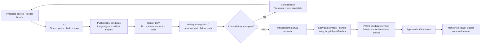

# Release promotion plan — build once, test in DEV, approve, then PROD

This is an implementation blueprint, not an executable pipeline or a claim that Azure checks have run. Azure DevOps is the chosen CI/CD tool; private runners reach private ACR/Blob/Container Apps endpoints. The existing assessment 2 API does not change for DEV versus PROD: runtime configuration and authorized identities do.

## Required stage dependencies

There is **no dependency path from CI directly to PROD**. Both the successful DEV report and protected approval are prerequisites. Merely pushing a Git tag or supplying a production registry URL does not bypass them. Any code/model/dependency change after DEV testing invalidates the report and starts a new candidate.

## Stage and permission contract

| Stage | Identity / permissions | Output and pass condition |
| --- | --- | --- |
| CI and candidate publication | DEV CI identity; DEV archive/image write only; no PROD deployment role | Commit SHA, model version, feature schema, graph/spec/manifest hashes, image digest, unit/parity/scan results |
| DEV deployment | DEV deployer scoped to `rg-steam-dev`; DEV app uses DEV-only pull identity | Healthy candidate, exact version/digest match, no public ingress |
| DEV testing and debugging | Engineering/test clients and runner with DEV API app role | Signed or otherwise protected report for the exact digest/configuration; all mandatory checks pass |
| Approval | Named release owner independent of routine DEV debugging | Approval bound to digest + evidence and recorded in a protected Azure DevOps environment check; self-approval disallowed where policy requires |
| Artifact promotion | Dedicated protected release identity; read approved DEV artifacts, write PROD artifacts | Target image digest and artifact hashes equal candidate; no rebuild, re-export or retraining |
| PROD deployment | Protected PROD deployer; PROD-only network access and scoped Container Apps change permissions | Healthy new revision, correct PROD audience/clients, expected version/predictions |
| Cutover / rollback | Authorized release owner/operator, separately auditable permissions | Approved traffic weights, monitored rollout, prior revision/image retained |

Configure approvals/checks on protected environment/resources, not as an unprotected in-script boolean. Review source/workflow changes through protected branches, keep PROD credentials inaccessible to unapproved jobs, and do not run arbitrary PR code on a privileged production runner. Azure documents [approvals and checks](https://learn.microsoft.com/en-us/azure/devops/pipelines/process/approvals?view=azure-devops) as resource-owner controls outside the YAML authoring process.

## DEV debugging and release acceptance

1. **Startup and artifact integrity:** checksum/schema/version checks, valid ONNX graph/probabilities, readiness only after warm-up; missing/corrupt artifacts must fail closed.
2. **API/preprocessing behavior:** full `games.csv` JSON field names, known expected owner band/probability tolerance, missing values, unseen labels, dates/one-year policy, invalid input and request limits. Outcomes/identities/media URLs must not affect model inputs.
3. **Identity and private access:** authorized DEV client succeeds; missing/invalid token returns 401, wrong client/role returns 403; reject PROD tokens against DEV and DEV tokens against the PROD-configured API in a controlled acceptance setup. Confirm public-network requests cannot reach the API or artifact stores.
4. **Resource behavior:** proposed DEV default is one replica; use min two and production-like CPU/memory/zone settings for release failure/load tests. Measure sustained demand (at least 100/hour) and an agreed burst profile, HTTP p50/p95, error/saturation rate and resource use.
5. **Recovery:** verify traffic survives a replica failure within the agreed objective; reject an unhealthy revision; restore the previous healthy DEV revision. Rehearse production rollback before cutover and ensure the previous production release remains recoverable.
6. **Quality and governance:** attach the offline selection/holdout evidence, declared business tradeoff and any outstanding limitations. Debugging data does not become a new untouched holdout. Local 79-test/100-request checks are useful input, not substitutes for these Azure acceptance tests.

Fixes go through source control and a new immutable candidate; do not modify model files inside a running DEV instance and promote that untraceable state. Tests and manual approval are tied to the actual digest; moving tags such as `latest` do not identify a tested release.

## Artifact storage and promotion

Use separate private storage accounts for DEV candidates and PROD approved artifacts. Store paths such as `<model-version>/<bundle-digest>/model.onnx`, `preprocessing.json`, `manifest.json` plus the release report, with versioning/retention and scoped pipeline access. Record the manifest's own checksum in the release evidence in addition to the graph/spec checksums it contains. No end user or general DEV identity gets PROD artifact access.

The chosen runtime still reads `/app/model` bundled into the image and needs no Blob reader role. Promotion copies the exact tested image to PROD ACR and the exact bundle to PROD Blob as an archive. If OCI copying changes the manifest digest, stop and investigate instead of claiming identical promotion. Do not rebuild with a different base image, dependency lock, converter, model or preprocessing settings after DEV tests; those are new candidates.

A future external-artifact startup mechanism would need an explicit image/bundle compatibility contract, pinned Blob version/hash, managed-identity access, atomic local staging and startup failure handling. Native Blob mounting in Container Apps is not supported; do not treat the supplied picture's mount arrow as a ready-to-use volume configuration. See [supported storage types](https://learn.microsoft.com/en-us/azure/container-apps/storage-mounts).

## Release evidence record

At minimum, retain commit/source provenance, model/feature versions, input dataset/split identifiers, graph/spec/manifest SHA-256 values, candidate and target image digests, DEV/PROD configuration identifiers, DEV test report, reviewer/approval time, scan status, production revision/cutover time, and rollback target. Do not put credentials, access tokens or raw game payloads in this record.

## Remaining implementation work

Provision the isolated DEV/PROD infrastructure and runner connectivity, configure Entra/OIDC/RBAC, implement the protected Azure DevOps stage dependency chain, publish signed release evidence, and execute the documented gates. The template files and this plan deliberately contain no Azure deployment commands or active repository workflow. Assessment 2 local verification and assessment 4 model results remain unchanged.
